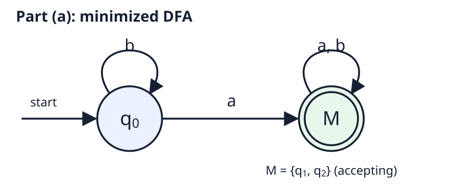
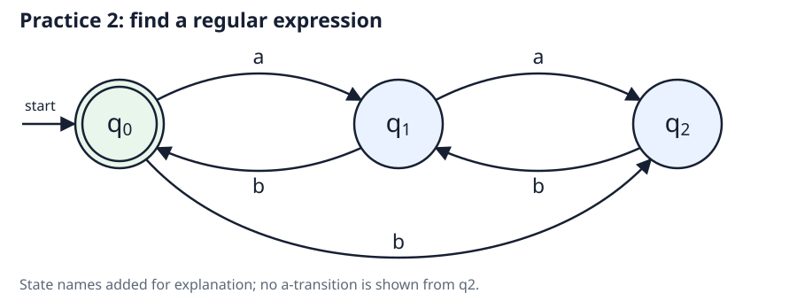
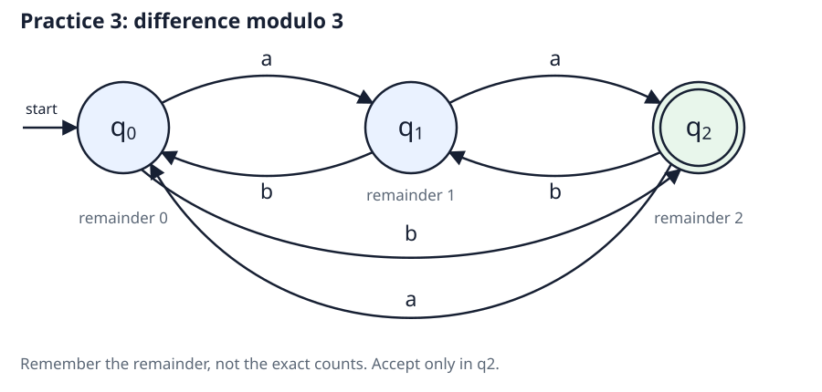

# Weeks 6–8 — Nondeterminism & Regular Languages

**Course:** COT 4210 — Automata Theory & Formal Languages (USF Fall 2026)
**Topics:** nondeterministic finite accepters, DFA equivalence, state minimization, regular expressions, regular grammars.
**Sections:** 2.2 Nondeterministic Finite Accepters (PDF pp. 95–104), 2.3 Equivalence of Deterministic and Nondeterministic Finite Accepters (PDF pp. 108–117), 2.4 Reduction of the Number of States in Finite Automata (PDF pp. 120–128), 3.1 Regular Expressions (PDF pp. 133–139), 3.2 Connection Between Regular Expressions and Regular Languages (PDF pp. 142–158), 3.3 Regular Grammars (PDF pp. 163–176).
**Source:** Peter Linz, *An Introduction to Formal Languages and Automata*, **6th ed.**, local `COT 4210.pdf`. Page numbers refer to PDF pages, not printed pages; the course lists the 7th edition. Ranges include section-ending discussion before exercise lists, but exercises are not used here.

> **Study scope.** Concept-focused private study aids, not assignment solutions or submitted work.

---

## 1. Nondeterministic Finite Accepters — Section 2.2

A DFA follows one computation. An NFA describes several possible computations: acceptance needs **one successful complete route**, not success on every route. Think of exploring alternatives, not of a machine randomly selecting one route.

> **Definition (Nondeterministic Finite Accepter).** An NFA is a quintuple $M = (Q, \Sigma, \delta, q_0, F)$ with the same state, alphabet, initial-state, and final-state components as a DFA, but with transition function

$$
\delta : Q \times (\Sigma \cup \lbrace \lambda \rbrace ) \to 2^Q.
$$

Here $2^Q$ is the powerset of $Q$: each result is a **set** of possible next states, including possibly the empty set.

| Feature | DFA | NFA in Linz |
|---|---|---|
| Result of a one-symbol transition | One state | A set of states |
| Choices for a state-symbol pair | Exactly one | Zero, one, or several |
| Move without reading input | Not allowed | A $\lambda$-transition |
| Missing graph edge for a symbol | Must complete the DFA | Empty transition set |
| Acceptance after all input | Unique endpoint is final | At least one possible endpoint is final |

A graph has an edge from $p$ to $q$ labeled $a$ exactly when $q \in \delta(p, a)$. A $\lambda$-edge changes state without consuming input; its label contributes nothing to the string read. Linz includes these moves in the term **NFA**.

### 1.1 Extended Transitions and Acceptance

> **Definition (NFA Extended Transition Function).** $\delta^{\ast}(p, w)$ is the set of all states reachable from $p$ by a walk labeled $w$, including any $\lambda$-moves before, between, or after its symbols.

$$
\delta^{\ast} : Q \times \Sigma^{\ast} \to 2^Q.
$$

The direct transition $\delta(p, \lambda)$ lists destinations of **one** $\lambda$-move. In contrast, $\delta^{\ast}(p, \lambda)$ includes $p$ itself and every state reachable by zero or more such moves. Similarly, $\delta^{\ast}(p, a)$ may include more than the direct destinations $\delta(p, a)$.

> **Definition (Language Accepted by an NFA).** The accepted language is

$$
L(M) = \lbrace w \in \Sigma^{\ast} : \delta^{\ast}(q_0, w) \cap F \ne \varnothing \rbrace .
$$

A route that gets stuck or finishes in a nonfinal state does not invalidate another accepting route. Visiting a final state while unread input remains is not enough. The empty string is accepted precisely when a final state is reachable from $q_0$ using only $\lambda$-moves.

A **dead configuration** has no move available for the remaining input on that route. If the complete reachable-state set becomes empty, no route can accept that input.

### 1.2 Computing Reachability

> **Definition ($\lambda$-Closure).** For a set of states $S$, $E(S)$ contains all states reachable from some state in $S$ by zero or more $\lambda$-moves. Thus $S \subseteq E(S)$.

A convenient set-based formulation starts with the closure of the initial state and repeats “read one symbol, then take closure”:

$$
S_0 = E(\lbrace q_0 \rbrace ),
\qquad
S_{i+1} = E\left(\bigcup_{q \in S_i} \delta(q, a_{i+1})\right).
$$

After reading $w = a_1\cdots a_n$, $S_n = \delta^{\ast}(q_0, w)$. Accept when $S_n$ contains a final state. Closure exploration records already visited states, so $\lambda$-cycles do not force endless exploration.

The book also gives a finite bound for labeled-walk enumeration. If a walk labeled $w$ exists, one exists whose number of edges is at most

$$
\Lambda + (1 + \Lambda)|w|,
$$

where $\Lambda$ is the number of $\lambda$-edges in the graph. Repeated empty-label cycles can be removed without changing the input label. This makes exhaustive bounded enumeration possible; tracking reachable sets avoids enumerating all those walks.

### 1.3 Why Nondeterminism?

- **Simpler descriptions:** alternatives in a language can be represented by alternative routes rather than encoded into one deterministic choice.
- **Search model:** a deterministic procedure can explore choices with search and backtracking, or retain all current possibilities as a set.
- **Simpler arguments:** constructions for union, concatenation, and repetition fit naturally into NFAs.

Nondeterminism changes the representation, not the family of languages recognized by finite accepters.

---

## 2. DFA–NFA Equivalence — Section 2.3

> **Definition (Equivalent Accepters).** Two finite accepters are equivalent exactly when $L(M_1) = L(M_2)$. Their graphs and state counts need not agree.

> **Theorem (DFA–NFA Equivalence).** Every NFA has an equivalent DFA, and every DFA can be viewed as an NFA with singleton transition sets and no $\lambda$-moves. Both recognize exactly the regular languages.

### 2.1 Subset Construction

One DFA state represents the **entire set of NFA states currently possible**. The DFA is not choosing an NFA route; it is updating that set deterministically.

For $M_N = (Q_N, \Sigma, \delta_N, q_0, F_N)$, use reachable subsets of $Q_N$ as DFA states. With $E$ denoting the NFA's $\lambda$-closure, define

$$
S_0 = E(\lbrace q_0 \rbrace ),
$$

$$
\delta_D(S, a) = E\left(\bigcup_{q \in S} \delta_N(q, a)\right),
$$

$$
F_D = \lbrace S \in Q_D : S \cap F_N \ne \varnothing \rbrace .
$$

1. Begin with $S_0$ as the initial DFA state.
2. For each discovered subset and each alphabet symbol, compute its destination subset.
3. Reuse an existing subset-state or add it if new; continue until every discovered state has all transitions.
4. Mark a subset accepting exactly when it contains at least one NFA final state.

If a transition yields $\varnothing$, that subset is a nonfinal DFA trap; all its transitions return to $\varnothing$. Do not omit it if it is reachable: the DFA transition function must be total.

The book's procedure instead starts with the label $\lbrace q_0 \rbrace$, unions extended one-symbol transitions $\delta_N^{\ast}(q, a)$, and separately marks its initial vertex final if the NFA accepts $\lambda$. The closure-first formulation above incorporates the empty-string case directly and keeps every reachable subset closed under $\lambda$-moves.

### 2.2 Why the Construction Works

The invariant is that after each input prefix the DFA's subset equals the NFA's possible-state set. It holds initially by closure and is preserved by each symbol update. Therefore, the two machines agree on final-state reachability for every complete input, not just sampled strings.

For an NFA with $n$ states, there are at most $2^n$ subset-states. Only reachable subsets need to be created. The constructed DFA may still have indistinguishable subset-states that can be merged later. Finiteness guarantees termination, while the possible exponential growth explains why an NFA can be a much more compact description.

**Complement caution:** exchanging final and nonfinal states directly in an NFA is not the DFA complement construction. An input can have both final and nonfinal endpoints. To complement its language by a final-state swap, first convert to a complete DFA.

---

## 3. Reducing the Number of States — Section 2.4

Two states can look different but remember exactly the same information for future acceptance. Minimization removes states that cannot occur and merges states that no possible continuation can tell apart.

> **Definition (Inaccessible State).** A state is inaccessible if no input string takes the initial state to it. Removing inaccessible states and their associated transitions does not change the accepted language.

### 3.1 Distinguishable and Indistinguishable States

> **Definition (Indistinguishability).** DFA states $p$ and $q$ are indistinguishable if every continuation gives the same accept/reject result:

$$
p \sim q
\quad\Longleftrightarrow\quad
\text{for every } w \in \Sigma^{\ast},\quad
\delta^{\ast}(p, w) \in F \iff \delta^{\ast}(q, w) \in F.
$$

> **Definition (Distinguishing String).** States are distinguishable if some string $w$ makes exactly one of the two resulting states final. Such a $w$ is a distinguishing string.

The empty string distinguishes any final state from any nonfinal state. Being both final or both nonfinal is necessary for indistinguishability, but not sufficient: future symbols may separate them.

Indistinguishability is an equivalence relation: reflexive, symmetric, and transitive. Its equivalence classes are the groups that may be merged. Equivalent states must have equivalent successors on every input symbol.

### 3.2 Marking Distinguishable Pairs

The book's **mark** procedure is a table-filling method:

1. Remove inaccessible states.
2. Mark each unordered pair containing one final and one nonfinal state.
3. For each unmarked pair $(p, q)$ and each $a \in \Sigma$, check the pair $(\delta(p, a), \delta(q, a))$. If that successor pair is marked, mark $(p, q)$.
4. Repeat until a complete pass adds no marks. Remaining unmarked pairs are indistinguishable.

Why propagate backward? If $w$ distinguishes the successors after $a$, then $aw$ distinguishes the original states. The initial marks correspond to $\lambda$; later marks detect longer continuations. There are only finitely many pairs to mark, so the procedure terminates and finds every distinguishable pair.

**Partition refinement** expresses the same idea by grouping final states separately from nonfinal states, then splitting a group whenever its states send some symbol into different current groups. Continue until no group splits; omit empty groups.

### 3.3 Building the Reduced DFA

Create one new state for each indistinguishability class $[q]$ of accessible states:

$$
\delta_{\text{red}}([q], a) = [\delta(q, a)].
$$

- Initial state: the class containing $q_0$.
- Final states: the classes containing original final states.
- Transitions: follow the original transition and take its destination class.

The transition is well-defined because any representatives of the same class lead to the same destination class. A class cannot mix final and nonfinal states.

> **Theorem (Minimal DFA).** Removing inaccessible states and merging indistinguishable states yields an equivalent DFA with the fewest possible states.

Minimality depends on both conditions: every remaining state is reachable, and every distinct pair is distinguishable. A smaller equivalent DFA would have to identify two reachable input histories that some continuation distinguishes, causing it to give the same answer where the language requires different answers. This procedure minimizes **DFAs**, not NFAs.

### 3.4 Exam Practice — Remove an Unreachable State and Merge Equivalent States

Example — DFA minimization, part (a)

**Source:** the supplied exam-practice diagram, part (a), not a textbook exercise or submitted assignment.

**Question.** Minimize the following DFA over inputs `a` and `b`. The start state is $q_0$, and the accepting states are $q_1$ and $q_2$.

| Original state | On `a` → | On `b` → | Accepting? |
|---|---|---|---|
| $q_0$ — start | $q_1$ | $q_0$ | No |
| $q_1$ | $q_2$ | $q_1$ | Yes |
| $q_2$ | $q_1$ | $q_2$ | Yes |
| $q_3$ | $q_1$ | $q_2$ | No |

Solution

1. **Remove the unreachable state.** No transition enters $q_3$, and it is not the start state. No input from $q_0$ can reach it, so remove $q_3$ and its outgoing arrows.
2. **Merge the equivalent accepting states.** Both $q_1$ and $q_2$ are accepting. On either symbol, each stays within their group, so every continuation is accepted from both. Name their merged state $M$.
3. **Redirect transitions to the merged state.** Any original destination $q_1$ or $q_2$ becomes $M$. In particular, their `a` arrows between each other become an `a` self-loop; their `b` self-loops also remain inside $M$.

| Reduced state | On `a` → | On `b` → | Accepting? |
|---|---|---|---|
| $q_0$ — start | $M$ | $q_0$ | No |
| $M$ — merged $q_1, q_2$ | $M$ | $M$ | Yes |

**Minimum: two states.** Both are reachable: $q_0$ is the start state, and `a` reaches $M$. They cannot merge because the empty continuation $\lambda$ rejects from $q_0$ but accepts from $M$.

**Key distinction:** the groups $q_0$, $q_3$, and the merged $q_1, q_2$ describe equivalence before unreachable-state removal. Reading `b` distinguishes $q_0$ from $q_3$, but $q_3$ is still removed because it is unreachable. Only reachable groups belong in the final minimized DFA.

---

## 4. Regular Expressions — Section 3.1

A regular expression describes a language by combining choices, sequences, and repetitions. The expression is notation; the language it denotes is a set of strings.

> **Definition (Regular Expression).** Over alphabet $\Sigma$, the primitives are $\varnothing$, $\lambda$, and each symbol $a \in \Sigma$. From regular expressions $r_1$ and $r_2$, form $r_1 + r_2$, $r_1r_2$, $r_1^{\ast}$, and $(r_1)$. Only expressions obtained by finitely many such steps are regular expressions.

### 4.1 Language Meaning and Precedence

| Expression | Denoted language / operation |
|---|---|
| $\varnothing$ | Empty language: no strings |
| $\lambda$ | $\lbrace \lambda \rbrace$: the empty string only |
| $a$ | $\lbrace a \rbrace$: one one-symbol string |
| $r_1 + r_2$ | Union of the two languages |
| $r_1r_2$ or $r_1 \cdot r_2$ | Concatenation of the two languages |
| $r^{\ast}$ | Zero or more repetitions of strings from $L(r)$ |
| $(r)$ | Same language; parentheses control grouping |

The recursive semantic rules are

$$
\begin{aligned}
L(r_1 + r_2) &= L(r_1) \cup L(r_2),\\
L(r_1r_2) &= L(r_1)L(r_2),\\
L(r^{\ast}) &= (L(r))^{\ast}.
\end{aligned}
$$

Precedence is **star, then concatenation, then union**; parentheses override it. Thus $ab + c$ means $(ab) + c$, not $a(b + c)$. In Linz, $+$ means union, not “one or more repetitions.” Concatenation is usually written without a dot.

### 4.2 Reading and Describing Languages

Read an expression in pieces: determine each component's language, then apply its outer operation. Star repeats whole strings from its operand, not arbitrary rearrangements of their symbols.

When describing a language, separate required pieces from arbitrary surrounding input, alternative cases, and repeatable blocks. Check empty strings, short boundary cases, and the permitted ending; a repeated block may describe interior behavior without covering every valid ending.

> **Definition (Equivalent Regular Expressions).** Expressions $r$ and $s$ are equivalent when $L(r) = L(s)$, even if their syntax differs.

The empty language and empty string are not interchangeable. Useful semantic simplifications, written as equivalences of expressions, are

$$
\begin{aligned}
r + \varnothing &\equiv r,\\
r\varnothing &\equiv \varnothing r \equiv \varnothing,\\
r\lambda &\equiv \lambda r \equiv r,\\
\varnothing^{\ast} &\equiv \lambda.
\end{aligned}
$$

Union is commutative; concatenation generally is not. The primitive syntax has no complement operator: a complementary regular language has an expression, but not generally one obtained by a simple local change of the original expression.

---

## 5. Expressions and Regular Languages — Section 3.2

> **Theorem (Expression–Automaton Equivalence).** Every regular expression denotes a regular language, and every regular language is denoted by some regular expression.

### 5.1 From an Expression to an NFA

Build an NFA recursively, following the expression's structure. Keep component states disjoint, and use fragments with distinct entrance and exit states. Before combination, the entrance has no incoming transitions and the exit has no outgoing transitions; the exit is the fragment's only final state.

| Expression component | NFA construction idea |
|---|---|
| $\varnothing$ | No route from entrance to exit |
| $\lambda$ | A $\lambda$-edge from entrance to exit |
| $a$ | An $a$-edge from entrance to exit |
| $r_1 + r_2$ | New entrance branches by $\lambda$ to either component; their exits join a new exit |
| $r_1r_2$ | Link first component's exit to second component's entrance by $\lambda$ |
| $r^{\ast}$ | Permit bypass for zero repetitions and a $\lambda$-link back for further repetitions |

For star, add a new entrance and exit: link entrance to both the component entrance and new exit, then link the component exit to both the component entrance and new exit. Old final states lose final status when embedded; only the combined exit is final. Otherwise a fragment could accept before a required following component is consumed.

Each construction implements exactly its corresponding language operation. Structural induction on the expression establishes correctness for every finite expression. Subset construction then gives a DFA if a deterministic accepter is needed.

### 5.2 Generalized Transition Graphs

> **Definition (Generalized Transition Graph).** A GTG is a transition graph whose edges are labeled by regular expressions. Traversing an edge contributes a string from its label's language; concatenating those choices along an initial-to-final walk gives an accepted string.

The GTG language includes all such strings over all accepting walks. A multiply labeled ordinary edge becomes a union expression. Missing edges receive $\varnothing$, and parallel alternatives combine by union. A **complete GTG** has one labeled edge for every ordered state pair, including self-loops; an empty-language edge allows no traversal.

### 5.3 From an Automaton to an Expression: State Elimination

First arrange a single final state distinct from the initial state. New boundary states and $\lambda$-links can do this without changing the language: the new initial state enters the old initial state, and each old final state links to the new sole final state.

Convert to a complete GTG. Let $r_{pq}$ denote the current label from $q_p$ to $q_q$. To eliminate an interior state $q_k$, update **every** pair of surviving states, including their self-loops:

$$
r_{pq}^{\prime} = r_{pq} + r_{pk}(r_{kk})^{\ast}r_{kq},
\qquad p,q \ne k.
$$

The first term preserves routes that avoid $q_k$; the second enters it, loops there zero or more times, and leaves it. Use the **old** labels for all updates in one elimination, then remove $q_k$ and its edges. Simplify empty-language terms as needed and repeat, preserving the initial and final states.

For a remaining two-state GTG with distinct initial state $q_i$ and sole final state $q_j$, the general expression is

$$
r = (r_{ii})^{\ast}r_{ij}\left(r_{jj} + r_{ji}(r_{ii})^{\ast}r_{ij}\right)^{\ast}.
$$

It allows initial loops, the first move to the final state, then any number of final-state loops or excursions back through the initial state. **Do not just read $r_{ij}$** unless the boundary construction ensures no incoming edges to the initial state and no outgoing edges from the final state; in that special arrangement the other terms simplify away.

Each elimination preserves the language. The process terminates because an interior state is removed at each step. Different elimination orders may produce very different expressions for the same language; a correct result need not be short or easy to read.

### 5.4 Simple Patterns and Practical Matching

Regular expressions can specify lexical patterns such as identifiers and numeric constants, or describe text-search patterns. The underlying construction can be organized as

$$
\text{regular expression} \longrightarrow \text{NFA}
\longrightarrow \text{DFA} \longrightarrow \text{reduced DFA}.
$$

The DFA transition table supplies the recognition rules; a driver reads input and uses the table. The pattern may be supplied at run time rather than fixed when the matcher is written. Minimization can reduce the storage required by a large constructed DFA.

**Practical syntax caveat:** Linz's mathematical expressions are not a specification of every editor or programming-language regex engine. Only features expressible by finite union, concatenation, and star are covered by these equivalences. Do not assume that every engine-specific extension is regular, or that its punctuation has the book's meaning. Also distinguish whole-string language membership from searching for a matching substring inside a larger text.

### 5.5 Exam Practice — Find a Regular Expression from Return Trips

Example — Practice problem 2: find the regular expression

**Source:** the supplied exam-practice image labeled "2. Find the regular expression," not a textbook exercise or submitted assignment. The original states are unlabeled; call the left, middle, and right states $q_0$, $q_1$, and $q_2$ for this explanation.

**Question.** Find a regular expression for the language accepted by this automaton. The left state $q_0$ is both the start and the only accepting state.

| State | On `a` → | On `b` → | Accepting? |
|---|---|---|---|
| $q_0$ — start | $q_1$ | $q_2$ | Yes |
| $q_1$ | $q_2$ | $q_0$ | No |
| $q_2$ | No transition | $q_1$ | No |

The long bottom `b` arrow points from $q_0$ to $q_2$. No `a` transition is shown from $q_2$; a route trying to read `a` there gets stuck and rejects.

Solution

**Idea:** describe one complete trip away from the accepting state and back, then allow that trip to repeat. Here $+$ means union (OR), and star means zero or more repetitions.

**1. Reach the middle state without returning to the start.** There are two routes:

| Route | Input read |
|---|---|
| $q_0$ directly to $q_1$ | `a` |
| $q_0$ to $q_2$, then to $q_1$ | `bb` |

These alternatives give $a+bb$.

**2. Repeat between the middle and right states.** From the middle, read `a` to go right and `b` to return. This reads `ab`. Repeat that loop zero or more times, giving $(ab)^{\ast}$.

**3. Return to the accepting state.** From $q_1$, one final `b` returns to $q_0$. A complete return trip therefore consists of the initial `a` or `bb` choice, zero or more `ab` loops, and a final `b`.

**4. Repeat whole return trips.** After returning to $q_0$, another trip can begin. Zero trips are also allowed because the start state is accepting, so the empty string $\lambda$ must be included.

**Why this is exact:** split any nonempty accepting walk at every return to $q_0$. Each piece first reaches $q_1$ by `a` or `bb`, makes some number of `ab` loops, and finishes with `b`. Conversely, every such piece returns to $q_0$, so any concatenation of these pieces is accepted.

**State-elimination view:** removing $q_2$ leaves a forward edge from $q_0$ to $q_1$ labeled $a+bb$, an `ab` self-loop at $q_1$, and a `b` edge back to $q_0$. Removing $q_1$ then leaves the complete-return-trip self-loop at the accepting start state; its star is the answer.

| String | Result | Reason |
|---|---|---|
| $\lambda$ | Accept | Zero trips; already at the accepting start |
| `ab` | Accept | Directly to the middle, then back |
| `bbb` | Accept | Through the right and middle states, then back |
| `aabb` | Accept | Direct start, one `ab` loop, final `b` |
| `bbabb` | Accept | `bb` start, one `ab` loop, final `b` |
| `abab` | Accept | Two complete `ab` return trips |
| `a` | Reject | Ends at the nonaccepting middle state |
| `bb` | Reject | Ends at the nonaccepting middle state |

**Middle/right loop (practice problem 2):**

$$
q_1 \xrightarrow{a} q_2 \xrightarrow{b} q_1.
$$

**One complete return trip:**

$$
(a+bb)(ab)^{\ast}b.
$$

**Final regular expression:**

$$
\boxed{R = \left((a+bb)(ab)^{\ast}b\right)^{\ast}}.
$$

### 5.6 Exam Practice — Difference Modulo 3: Language to DFA to Expression

**Language condition (practice problem 3):**

$$
(n_a(w)-n_b(w)) \bmod 3 = 2.
$$

Example — Practice problem 3: modulo-difference regular expression

**Source:** the supplied exam-practice language labeled 3, not a textbook exercise or submitted assignment. The image does not explicitly give an alphabet; assume inputs `a` and `b`, as in the discussion. The counts $n_a(w)$ and $n_b(w)$ are the numbers of those symbols in $w$.

**Question.** Construct an automaton for the language condition above, then find a regular expression for the same language.

Solution

**1. Decide what the DFA must remember.** Do not begin by guessing arrows. The exact counts can grow without bound, but only the difference's remainder matters. There are three possible remainders, so use $q_0$, $q_1$, and $q_2$ to remember remainders 0, 1, and 2. A state records the situation after the input read so far, not an individual letter or an exact count.

Before any input, the difference is zero, so start at $q_0$. The language requires remainder 2, so only $q_2$ is accepting. Reading `a` adds 1 to the difference; reading `b` subtracts 1. Wrap around modulo 3, including negative differences: reading `b` from remainder 0 reaches remainder 2.

| State | Remembered remainder | On `a` → | On `b` → | Accepting? |
|---|---|---|---|---|
| $q_0$ — start | 0 | $q_1$ | $q_2$ | No |
| $q_1$ | 1 | $q_2$ | $q_0$ | No |
| $q_2$ | 2 | $q_0$ | $q_1$ | Yes |

The state invariant is that $q_i$ means the difference has remainder $i$. It holds initially and is preserved by the add/subtract update, so the DFA accepts exactly the language condition.

**2. Eliminate the middle state.** Remove $q_1$ while preserving paths through it. Since $q_1$ has no self-loop, each newly combined route simply reads two symbols:

| Remaining route | Label | Why |
|---|---|---|
| $q_0$ to $q_0$ | $ab$ | `a` to the middle, then `b` back |
| $q_0$ to $q_2$ | $b+aa$ | Direct `b`, or `aa` through the middle |
| $q_2$ to $q_0$ | $a+bb$ | Direct `a`, or `bb` through the middle |
| $q_2$ to $q_2$ | $ba$ | `b` to the middle, then `a` back |

Here $+$ means OR, not one-or-more repetition. The reduced graph has expression-labeled edges; it is a generalized transition graph, not an ordinary one-symbol DFA.

**3. Describe a complete return to the start.** One return to $q_0$ either reads `ab`, or visits $q_2$ by `b` or `aa`, repeats the `ba` loop there zero or more times, and returns by `a` or `bb`. Call this complete-return pattern $A$.

**4. Describe the final accepting segment.** After any number of complete returns to $q_0$, take `b` or `aa` to reach $q_2$. Repeat its `ba` loop as desired, but do not return to $q_0$ again. Call this final segment $B$.

**5. Combine them.** Repeat complete-return segments zero or more times, then take one required final accepting segment. This gives $A^{\ast}B$, expanded below.

**Why this is exact:** cut a path in the reduced graph at each return to $q_0$. Each complete return has pattern $A$; the last segment ends at $q_2$ and has pattern $B$. Conversely, concatenating any such segments follows valid paths and ends accepting. The state-elimination step preserves the original DFA's language.

**Important:** unlike practice problem 2, the start state is not accepting. Do not put a star around the entire answer and accidentally include the empty string. The final segment is required.

| String | Difference | Remainder | Result |
|---|---|---|---|
| $\lambda$ | 0 | 0 | Reject |
| `a` | 1 | 1 | Reject |
| `b` | -1 | 2 | Accept |
| `aa` | 2 | 2 | Accept |
| `ab` | 0 | 0 | Reject |
| `aab` | 1 | 1 | Reject |
| `bba` | -1 | 2 | Accept |
| `bbbb` | -4 | 2 | Accept |
| `aaba` | 2 | 2 | Accept |

**Complete-return pattern (practice problem 3):**

$$
A = ab + (b+aa)(ba)^{\ast}(a+bb).
$$

**Final accepting segment:**

$$
B = (b+aa)(ba)^{\ast}.
$$

**Regular expression:**

$$
\boxed{R_3 = A^{\ast}B = \left(ab+(b+aa)(ba)^{\ast}(a+bb)\right)^{\ast}(b+aa)(ba)^{\ast}}.
$$

---

## 6. Regular Grammars — Section 3.3

An automaton tracks which situation remains; a regular grammar tracks which variable remains to finish generating a string. These are two views of the same finite-state structure.

### 6.1 Right-Linear, Left-Linear, and Merely Linear

> **Definition (Right-Linear Grammar).** Every production has form $A \to xB$ or $A \to x$, with $A,B \in V$ and $x \in T^{\ast}$. A remaining variable must be at the right end.

> **Definition (Left-Linear Grammar).** Every production has form $A \to Bx$ or $A \to x$, with the same restrictions on $A,B,x$. A remaining variable must be at the left end.

> **Definition (Regular Grammar).** A grammar is regular if the entire grammar is right-linear or the entire grammar is left-linear.

> **Definition (Linear Grammar).** Each production has one variable on its left side and at most one variable on its right side, without requiring that right-side variable to be consistently at one end.

| Grammar form | Remaining variable in a nonterminal sentential form | Restriction |
|---|---|---|
| Right-linear | At the right end of a terminal prefix | Consistently right-linear productions |
| Left-linear | At the left end of a terminal suffix | Consistently left-linear productions |
| Merely linear | May occur in the middle or alternate ends | At most one variable on a production's right side |

Since $x$ may be empty, terminal-only productions include $A \to \lambda$, and variable-only productions $A \to B$ fit either orientation. Terminal blocks may contain several symbols, not just one.

Every regular grammar is linear, but not every linear grammar is regular. Mixing genuinely left-linear and genuinely right-linear rules does not satisfy the regular-grammar definition and does not guarantee a regular language. Grammar form and generated language are different issues: a grammar that is not regular can still happen to generate a regular language.

### 6.2 From a Right-Linear Grammar to an NFA

Use one state for each grammar variable, start at $S$, and add a fresh sole final state $q_f$.

| Production | Corresponding NFA route |
|---|---|
| $A \to xB$ | A route labeled $x$ from state $A$ to state $B$ |
| $A \to x$ | A route labeled $x$ from state $A$ to $q_f$ |
| $A \to B$ | A $\lambda$-edge from $A$ to $B$ |
| $A \to \lambda$ | A $\lambda$-edge from $A$ to $q_f$ |

Expand a multi-symbol terminal block into a chain of one-symbol edges with fresh intermediate states. Other productions may supply other routes with the same input label, so the endpoint condition uses set membership, not equality with a single state:

$$
A \to xB \quad\Longrightarrow\quad B \in \delta^{\ast}(A, x),
$$

$$
A \to x \quad\Longrightarrow\quad q_f \in \delta^{\ast}(A, x).
$$

A derivation accumulates a terminal prefix while its rightmost variable identifies the next state. Finishing with a terminal-only rule corresponds to reaching $q_f$. This correspondence works in both directions: generated strings are accepted, and accepting routes determine derivations. Therefore, right-linear grammars generate regular languages.

### 6.3 From a Finite Accepter to a Right-Linear Grammar

For a DFA, create a variable $A_q$ for each state $q$, use the input alphabet as terminals, and choose $A_{q_0}$ as the start variable. Translate each transition and each final state into productions:

$$
\delta(q, a) = p \quad\Longrightarrow\quad A_q \to aA_p,
$$

$$
q \in F \quad\Longrightarrow\quad A_q \to \lambda.
$$

A transition consumes a symbol in the automaton and generates that symbol in the grammar. The final-state rule removes the remaining variable, so a terminal derivation finishes exactly where an accepting computation finishes. If the initial state is final, its empty-string production handles $\lambda$.

The same idea extends to NFAs: add a production for **each** transition destination, translate a $\lambda$-edge into a variable-only production, and keep the final-state empty-string productions. Thus every regular language has a right-linear grammar.

### 6.4 Left-Linear Grammars and Reversal

For a left-linear grammar $G$, replace each production by its reversed right-linear form to construct $\widehat{G}$:

$$
\begin{aligned}
A \to Bx &\quad\text{becomes}\quad A \to x^R B,\\
A \to x &\quad\text{becomes}\quad A \to x^R.
\end{aligned}
$$

$$
L(\widehat{G}) = (L(G))^R,
\qquad
L(G) = (L(\widehat{G}))^R.
$$

The change reverses the entire generated string, including the symbols inside each terminal block. Regular languages remain regular under reversal, so left-linear grammars also generate regular languages. Conversely, form a right-linear grammar for the reverse of a regular language and reverse its productions to obtain a left-linear grammar for the original language.

> **Theorem (Regular-Grammar Equivalence).** A language is regular if and only if some regular grammar generates it. Every regular language has both a right-linear grammar and a left-linear grammar.

### 6.5 Choosing a Representation

| Representation | Most direct view |
|---|---|
| DFA | One state update per symbol; table-driven recognition |
| NFA | Alternative routes and modular language constructions |
| Regular expression | Compact choices, sequences, and repetitions |
| Regular grammar | Production rules and derivations |

All four describe exactly the same family of languages. Their descriptions need not have comparable sizes or look alike; equivalence means that they accept, denote, or generate the same set of strings.

---

## Quick Reference

| Term / Symbol | Meaning |
|---|---|
| $2^Q$ | All subsets of the finite state set |
| $\lambda$-transition | Changes state without consuming input |
| $\delta^{\ast}(q,w)$ for an NFA | Set of endpoints of all walks labeled $w$ |
| $E(S)$ | States reachable from $S$ by zero or more $\lambda$-moves |
| NFA acceptance | At least one final endpoint after the complete input |
| subset construction | DFA states track reachable sets of NFA states |
| $\varnothing$ subset-state | Nonfinal trap in the constructed complete DFA |
| equivalent accepters | Same accepted language |
| distinguishing string | A continuation accepted from exactly one of two states |
| $p \sim q$ | Every continuation has the same acceptance result |
| minimization | Remove inaccessible states; merge indistinguishable classes |
| $L(r)$ | Language denoted by regular expression $r$ |
| $+$, concatenation, $^{\ast}$ | Union, sequence, zero-or-more repetition |
| precedence | Star before concatenation before union |
| $\varnothing$ vs. $\lambda$ | No strings vs. the empty string only |
| GTG | Transition graph with regular-expression edge labels |
| state elimination | Preserve direct routes and routes through the removed state |
| right-linear grammar | Rules $A \to xB$ or $A \to x$ |
| left-linear grammar | Rules $A \to Bx$ or $A \to x$ |
| regular grammar | Entire grammar is right-linear or left-linear |
| linear grammar | At most one right-side variable; not necessarily regular |
| $L(G)$ | Terminal strings derivable from the start variable |
| DFA, NFA, expression, regular grammar | Equivalent descriptions of regular languages |
